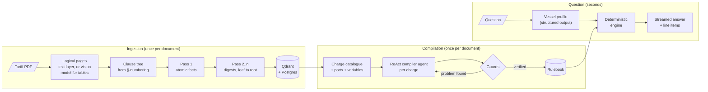
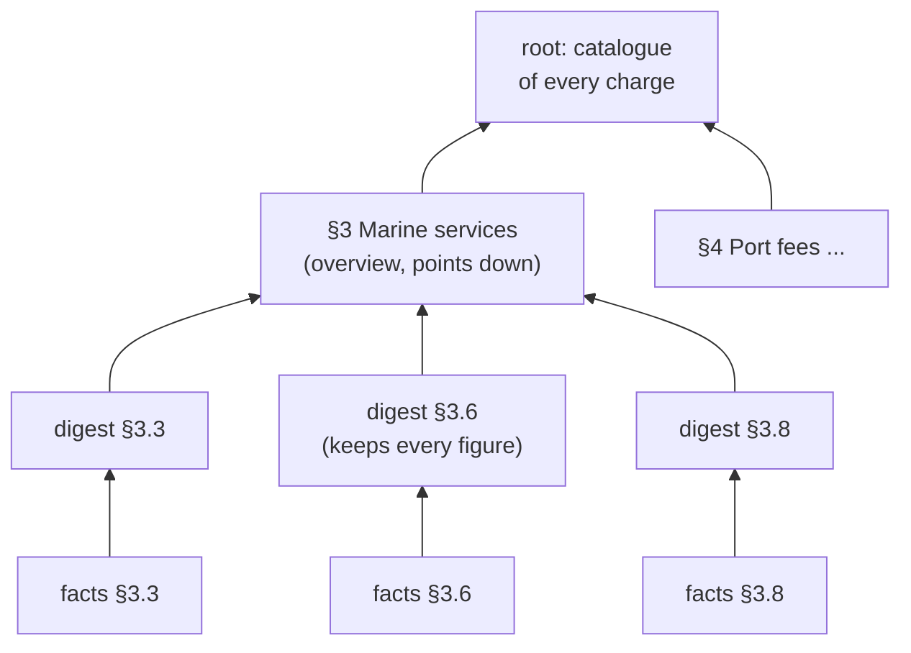
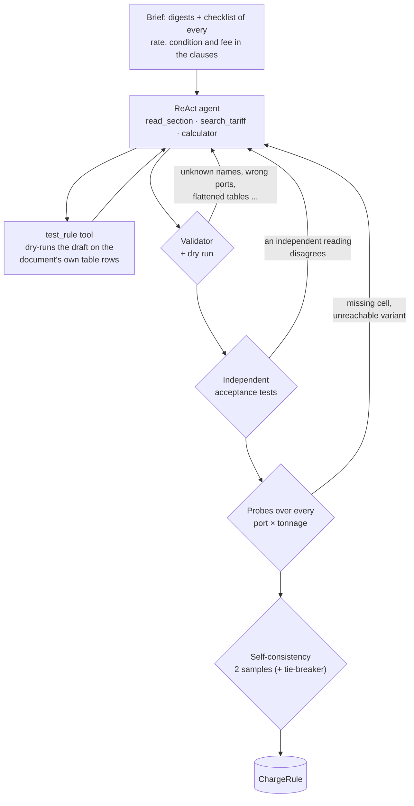
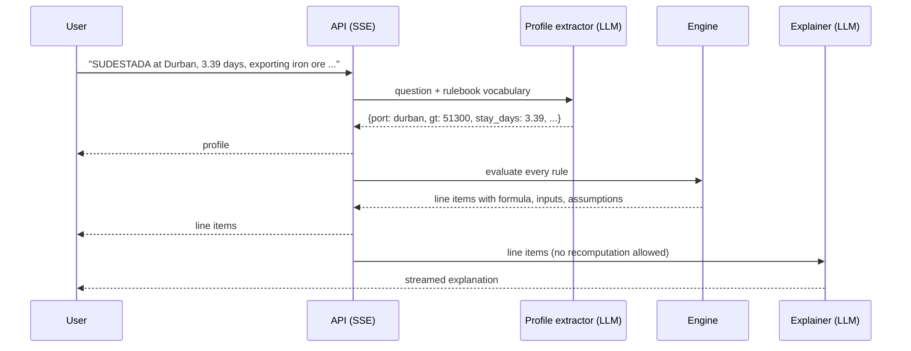

# Port Dues

**Compile a port tariff into executable rules once, then price any vessel call in seconds, with every figure traceable to a clause.**

Upload a tariff PDF. The system reads it, rebuilds its clause structure, and has an agent turn each charge
into a small typed formula, verified against the document's own tables. Questions are then answered by a
deterministic engine. The language model reads the question and writes the explanation, but never does the
arithmetic. Nothing about a port, a charge or a rate is written in the code.


## At a glance

| | |
|---|---|
| **Reference vessel** (SUDESTADA, Durban) | 4 of 6 charges exact to the cent, 2 within 0.09%; [the gap is in the brief's inputs](#the-reference-values) |
| **Golden set** (30 questions, easy/medium/hard) | compiled rules right on all 30 calls (29 in the offline check, the 30th verified through the chat); last full end-to-end run 96% of charges within ±1% |
| **Model** | everything on `gpt-6-luna`, the cheapest model available; matches a rulebook compiled by `gpt-6.1-sol` |
| **Cost** | ~$0.06 to read a 54-page tariff, ~$0.56 to compile its rules (once), **~$0.001 per question** |
| **Latency** | ~7 s per answer, streamed |
| **Stack** | LangChain + LangGraph, FastAPI (SSE), PostgreSQL, Qdrant, React, self-hosted Langfuse, Docker Compose |

## How it works



### 1. Reading the PDF

- **Pages.** Tariff books are often printed as two-up spreads, so landscape sheets are split into logical pages.
  Pages with tables (rows with several separated numeric cells) or figures are rendered and transcribed by the
  vision model. The PDF text layer is passed along, so the model copies digits instead of reading them off
  pixels. Plain text pages skip the model: 29 of 54 pages in the sample need vision.
- **Clause tree** from the document's own numbering (`SECTION 4` › `4.1` › `4.1.1`), not font sizes, which vary
  between documents. Running headers are dropped by frequency, and the contents page is detected and skipped.
- Restarted ingestions resume from checkpoints, so a crash never pays for vision twice.

### 2. A structure-aware RAPTOR

RAPTOR builds a summary tree by clustering chunks. A tariff book already says what belongs together, so the tree
follows the clauses instead:



Leaf digests keep every number; higher nodes are overviews that point down the tree. Verbatim text, facts and
digests are all embedded (`text-embedding-3-small`) so search can land on whichever level fits. **Digests are
for navigation only:** a figure that has been summarised twice is never used for arithmetic.

<details>
<summary>Screenshot: the clause tree with verbatim text, facts and digest per clause</summary>


</details>

### 3. Compiling the tariff into rules

Most charges are *rate × units, picked by port, size band or item, adjusted by conditions*. A `ChargeRule`
captures exactly that: port variants, numeric bands (`band()`), keyed tables for named items like commodities
(`lookup()`), constants that cite their clause, minimums, surcharges, reductions, exemptions, and `on_application`
for cases the document prices by agreement. Formulas are parsed with `ast` and walked by hand, never `eval`ed.

A ReAct agent writes one rule per charge. A small model makes mistakes, and each run makes *different* ones, so
every rule has to pass a series of checks before it's accepted:




### 4. Answering a question



The profile schema is generated from the rulebook's variables, so a document-specific fact (say, a tanker
certification) becomes a field without code changes. A fact the question doesn't give is never guessed. An
unnamed port or a missing commodity marks the charge *needs input*, and the answer asks for it. Follow-ups
("same call, but at night") change only what they mention.

## How I got here

Most of the work went into deciding *what* to build, and the decisions came from measurements, not taste.

### Agentic RAG, compiled rules, or both?

I built all three and ran the golden set through each (rules compiled by `gpt-6.1-sol`, questions on `gpt-6-luna`):

| Strategy | Charges within ±1% | Exact cases | Latency | Tokens per answer |
|---|---:|---:|---:|---:|
| **Compiled rules** (shipped) | **100%** | **30/30** | **7 s** | **5.9k** |
| Task-list agent + compiled rules | 100% | 30/30 | 55 s | 26k |
| Task-list agent, retrieval only (agentic RAG) | 70% | 16/30 | 112 s | 37k |

Retrieval-only agentic RAG handled single charges, but on full estimates it forgot charges and misread
time-based dues. With the rules as a tool, the agent matched the compiled pipeline but cost 4× the tokens and 8×
the latency for the same answers. So the agents went, and the compiled pipeline is the product.

### Which agent compiles best on a small model?

I expected a task-list agent (plan the reads, then write) to help a small model. On the same document and
validator, it didn't:

| Compiler on `gpt-6-luna` | Golden calls correct |
|---|---:|
| **ReAct** (shipped) | 98–99% |
| Task list | 75% |

Writing a rule in one shot from pre-gathered evidence loses what makes ReAct work here: when the model is unsure,
it goes back and reads the clause again.

### Making the cheapest model as good as the expensive one

A rulebook compiled by `gpt-6.1-sol` was the bar. Luna got there by catching each class of mistake it actually
made, rather than by prompting harder. Each row is a real failure from a real run:

| What Luna got wrong | What catches it now |
|---|---|
| Scoped light dues to `port in ['south african port']`, a rule that can never fire | port names must exist in the tariff |
| Flattened the dry-bulk table to `18.49 if import else 18.49` | identical-branch and unused-table checks; keyed tables with `lookup()` |
| Charged every ship the per-metre rate meant for locally registered craft | "never drop a qualifier" plus acceptance tests that always include a typical cargo ship |
| Dropped the Saldanha column above 50,000 GT from the towage table | probe every port × tonnage for missing cells |
| Put the 35% reduction before the 60% bunkers-only one, so the latter never applied | probe for variants that can never be reached |
| Gave the certified-tanker reduction to every tanker | rules may declare their own variables (`tanker_certified = false`) |
| Skipped the hourly PLO fee for tankers at Saldanha | facts checklist in the brief: every rate and fee must be modelled |
| Made a *different* mistake on each run | two independent samples per charge, third as tie-breaker |

Some failures were mine, and finding them mattered as much: the engine silently priced an unnamed port at the
"other ports" rate; acceptance tests were skipped without a word when they used symbolic expressions; and
single-rule recompiles leaked the old rule's variables. Each now has a test.

The result, compared over 2,264 priced charges with `portdues compare-rules`: the Luna rulebook matches the Sol
one everywhere, except where Luna applies the document's SAPS/SANDF exemptions for pilotage and berth dues. Sol
had missed those.

### The reference values

| Charge | System | Brief | |
|---|---:|---:|---|
| Light dues | 60,062.04 | 60,062.04 | exact |
| Port dues | 199,371.35 | 199,549.22 | brief's value needs a 3.396-day stay, not 3.39 |
| Towage | 147,074.38 | 147,074.38 | exact |
| VTS | 33,345.00 | 33,315.75 | brief's value needs 51,255 GT, not 51,300 |
| Pilotage | 47,189.94 | 47,189.94 | exact |
| Running lines | 19,639.50 | 19,639.50 | exact; this figure is §3.8 *berthing* |

Solving the brief's own numbers back through the tariff shows where the gaps come from. Port dues come out at
exactly 199,549.22 when the system is told the stay is 3.396 days (try it in the chat). VTS needs a tonnage that
the brief's other five charges don't use. Hard-coding either value would defeat the point of the exercise.
The system also reports what the brief leaves out: the real §3.9 line handling (3,309.12) and cargo dues
(426,000.00, payable by the exporter).

## Evaluation

The golden set has 30 questions, 10 each **easy**, **medium** and **hard**. They cover band edges, minimum fees,
every port, out-of-hours surcharges, navy exemptions, bunkers-only and short-stay reductions, coaster status and
messy agent emails. Labels come from an independent hand transcription of the tariff
(`scripts/golden/za_reference.py`), used only for labelling, never by the app. Writing it surfaced two of my own
labelling mistakes, which the system had got right.

Three ways to score, from free to complete:

| | Checks | Cost |
|---|---|---|
| `portdues check-rules <doc>` | compiled rules on the golden calls | free, deterministic |
| `portdues compare-rules <doc> other.json` | two rulebooks over ~300 calls, every disagreement listed | free |
| Experiments page / `portdues eval` | full pipeline, scored by numeric ±1%, an LLM judge, and [Laya](https://huggingface.co/convaiinnovations/laya) | ~$0.03 for 30 questions |

Laya is an open-source System-1 decision model (ModernBERT, calibrated probabilities). It answers typed yes/no
checks about coverage and presentation. In my tests it couldn't tell a right figure from a wrong one, so
correctness is left to the other two scorers.


## Observability and cost

Docker Compose runs a self-hosted **Langfuse** (web, worker, Postgres, ClickHouse, Redis, MinIO), provisioned
headlessly from `.env` with sign-up disabled. One chat turn is one trace, and every answer in the UI links to it.


Cost is measured, not estimated. Every ingestion stage, compile, answer and eval case records input, output,
cached and reasoning tokens and dollars, shown in the UI and in Langfuse. Langfuse initially under-counted:
OpenAI reports prompt-cache writes under a separate usage key that had no price. Every key is now priced, and the
two agree trace for trace.

| Stage (54-page tariff, `gpt-6-luna`) | Input | Output | Cost |
|---|---:|---:|---:|
| Vision (29 pages) | 75k | 16k | $0.016 |
| Facts + digests (82 clauses) | 100k | 67k | $0.044 |
| Rule compilation (18 rules, with self-consistency) | 3.5M (85% cached) | 413k | $0.56 |
| One answer | ~5–9k | ~0.5k | ~$0.001 |

<details>
<summary>More screenshots: documents and a follow-up question</summary>


</details>

## Running it

```bash
cp .env.example .env          # OPENAI_API_KEY, Langfuse admin login and keys
docker compose up --build -d  # app → http://localhost:8080 · Langfuse → http://localhost:3000
```

Upload the tariff PDF on the Documents page. Reading and compiling take about fifteen minutes, once; uploading
the same file again reuses everything. The Laya scorer adds a CPU build of PyTorch to the image
(`WITH_LAYA=false docker compose build` leaves it out).

<details>
<summary>Local development, CLI and tests</summary>

```bash
make infra && make langfuse                     # postgres :5434, qdrant :6333, langfuse :3000
cd backend && uv venv && uv pip install -e ".[dev,laya]"
.venv/bin/portdues ingest "../Port Tariff.pdf"
make api                                        # :8000
make web                                        # :5173, proxies /api
make test                                       # 54 tests: engine, compiler guards, sectioning, scoring
```

| CLI | |
|---|---|
| `portdues ingest <pdf>` / `--compile-only <doc> [--rules id ...]` | read and compile, or recompile the rulebook or single rules |
| `portdues ask <doc> "question"` | one question from the terminal |
| `portdues check-rules <doc>` | free rulebook score on the golden calls |
| `portdues compare-rules <doc> rulebook.json` | free comparison with another rulebook |
| `portdues eval <doc> --limit 9` | an experiment from the terminal |

Models, effort levels, prices and compile samples are all set in `.env` (`COMPILER_MODEL`, `FAST_MODEL`,
`JUDGE_MODEL`, `MODEL_PRICES`, `COMPILE_SAMPLES`); see `.env.example`.
</details>

<details>
<summary>API</summary>

| Method | Path | |
|---|---|---|
| `POST` | `/api/documents` | upload a PDF; starts ingestion, deduplicated by hash |
| `GET` | `/api/documents`, `/api/documents/{id}` | status, progress, stats, tokens and cost |
| `POST` | `/api/documents/{id}/reingest?compile_only=` | rebuild everything, or only the rulebook |
| `POST` | `/api/documents/{id}/rules/{rule_id}/recompile` | recompile one rule |
| `GET` | `/api/documents/{id}/tree`, `/sections/{node}` | clause tree with digests, facts and verbatim text |
| `GET` | `/api/documents/{id}/rulebook` | compiled rules and how they were produced |
| `POST` | `/api/chat` | SSE stream of one turn |
| `GET` | `/api/conversations/{id}/messages` | chat history with each turn's line items and trace link |
| `POST` | `/api/experiments`, `GET /api/experiments/{id}/stream` | start a run; live per-case scores over SSE |
</details>

<details>
<summary>Layout</summary>

```
backend/portdues
  ingestion/   pages.py (PDF + vision) · sections.py (clause tree) · tree.py (facts + digests) · pipeline.py
  rules/       schema.py (rule language) · engine.py (evaluator, validator) · compiler.py (agent + guards)
  agents/      tools.py (tree tools) · profile.py (question → call profile) · strategies.py (answering)
  evals/       golden.jsonl · scorers.py · runner.py · rulebook_check.py (check-rules, compare-rules)
  storage/     db.py (PostgreSQL) · vectors.py (Qdrant)
  api/         FastAPI routers (documents, chat, experiments)
backend/scripts/golden   dataset builder and the labelling reference
frontend/src             React app: documents, chat, experiments
```
</details>

## Limitations

- A small model's compile still varies from run to run. The guards bring it to the Sol rulebook's results on
  this tariff, but a human review of the rulebook (approve or edit a rule) is the next feature I'd build before
  using it for invoices.
- Situational services that aren't compiled (dry-docking, fire services, equipment hire) are listed as not
  priced rather than researched.
- If the question doesn't name the port, the answer asks for it; a port selector in the chat would make the
  "given vessel and port" input explicit.
- A tariff plus a separate amending notice would need rule precedence by effective date.
- VAT is reported, not added, matching how the reference values are stated.
