# Port Dues

**Compile a port tariff into executable rules once, then price any vessel call in seconds, with every figure traceable to a clause.**

Upload a tariff PDF. The system reads it, rebuilds its clause structure, and has an agent turn each charge into a
small typed formula, verified against the document's own tables. Questions are then answered by a deterministic
engine. The language model reads the question and writes the explanation, but never does the arithmetic.
Nothing about a port, a charge or a rate is written in the code; point it at another port's tariff and it builds
that port's rulebook.

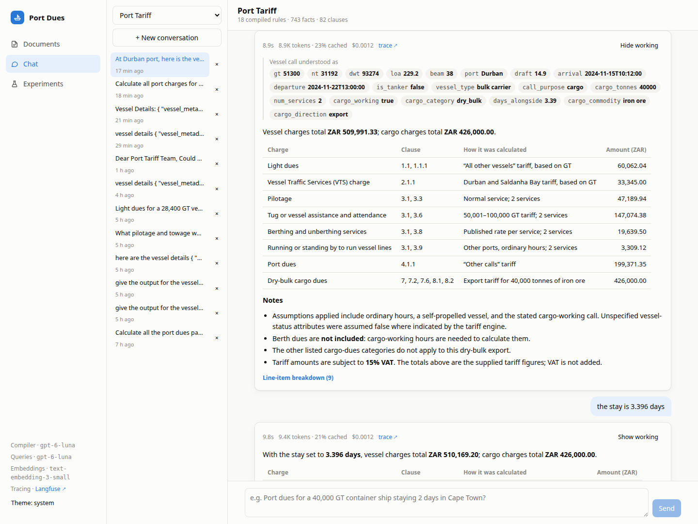

## At a glance

| | |
|---|---|
| **Reference vessel** (SUDESTADA, Durban) | 4 of 6 charges exact to the cent, 2 within 0.09%; [the gap is in the brief's inputs](#the-reference-values) |
| **Golden set** (30 questions, easy/medium/hard) | all 30 calls priced correctly by the compiled rules |
| **Model** | everything on `gpt-6-luna`, the lowest-cost model available; each role's model is configurable |
| **Cost** | ~$0.06 to read a 54-page tariff, ~$0.56 to compile its rules (once), **~$0.001 per question** |
| **Latency** | ~7 s per answer, streamed token by token |
| **Stack** | LangChain + LangGraph, FastAPI (SSE), PostgreSQL, Qdrant, React, self-hosted Langfuse, Docker Compose |

## How it works

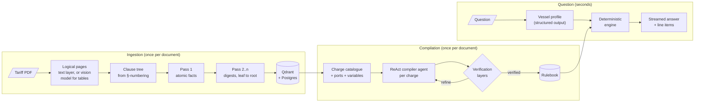

### 1. Reading the PDF

- **Pages.** Tariff books are often printed as two-up spreads, so landscape sheets are split into logical pages.
  Pages with tables (rows with several separated numeric cells) or figures are rendered and transcribed by the
  vision model. The PDF text layer is passed along, so the model copies digits rather than reading them off
  pixels. Plain text pages skip the model: 29 of 54 pages in the sample go through vision.
- **Clause tree** from the document's own numbering (`SECTION 4` › `4.1` › `4.1.1`), independent of fonts and
  layout. Running headers are dropped by frequency, and the contents page is detected and skipped.
- **Resumable.** Vision transcriptions and extracted facts are checkpointed, so a restarted ingestion picks up
  where it stopped.

### 2. A structure-aware RAPTOR

RAPTOR builds a summary tree by clustering chunks. A tariff book already says what belongs together, so the tree
follows its clauses:

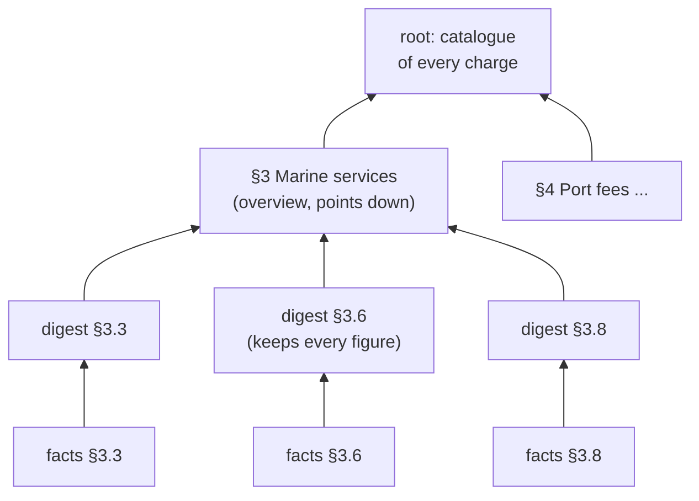

Leaf digests keep every number, and higher nodes are overviews that point down the tree. Verbatim text, facts
and digests are all embedded (`text-embedding-3-small`), so search lands on whichever level fits. Digests drive
navigation; numbers always come from verbatim clause text.

<details>
<summary>Screenshot: the clause tree with verbatim text, facts and digest per clause</summary>

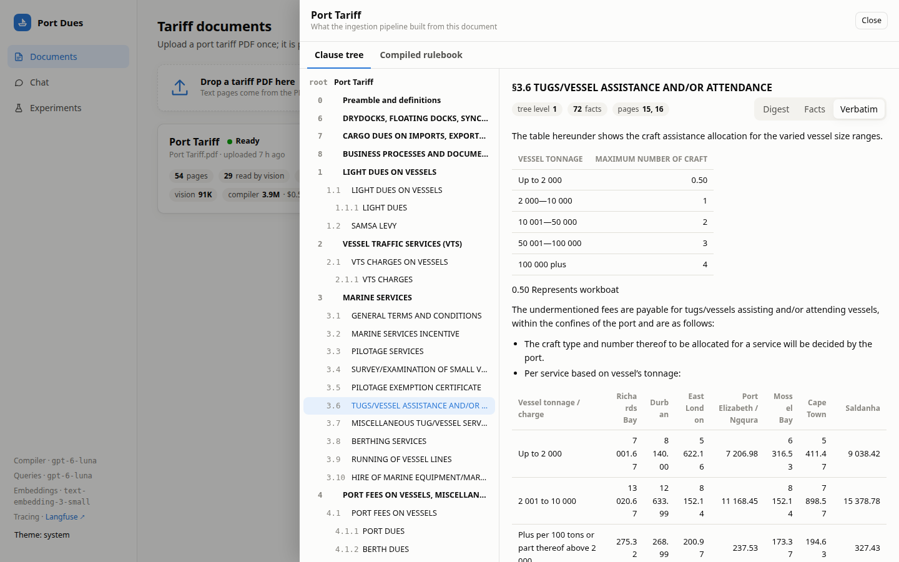
</details>

### 3. Compiling the tariff into rules

Most charges are *rate × units, picked by port, size band or item, adjusted by conditions*. A `ChargeRule`
captures exactly that:
- port variants;
- numeric bands (`band()`) and keyed tables for named items such as commodities (`lookup()`);
- constants that cite their clause;
- minimums, surcharges, reductions and exemptions;
- `on_application` for cases the document prices by agreement.

Formulas are parsed with `ast` and walked by hand, never `eval`ed.

For each charge, a ReAct agent reads the clauses and writes the rule. Every rule then passes through layered
verification before it enters the rulebook:

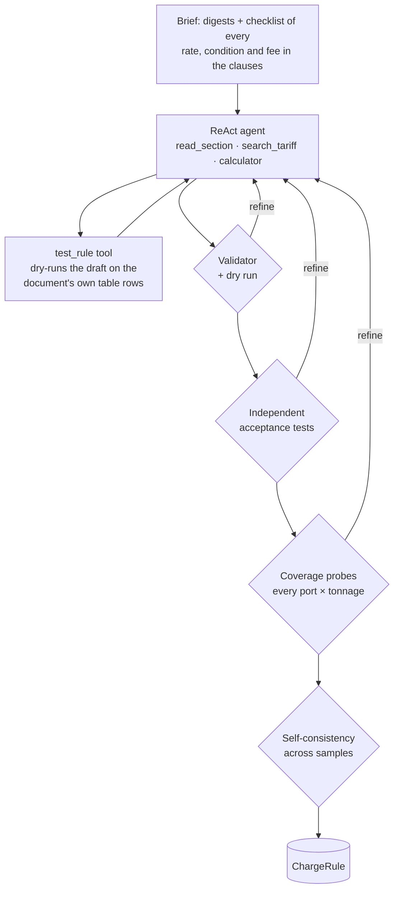

| Layer | What it guarantees |
|---|---|
| **Facts checklist** | every rate, condition and fee extracted from the clauses is modelled or explicitly noted |
| **`test_rule` tool** | the agent checks its draft against rows of the document's own tables before submitting |
| **Validator and dry run** | formulas parse; every variable, table and port name exists in the tariff; no table goes unused |
| **Independent acceptance tests** | a separate model call writes test calls from the verbatim clause without seeing the rule; both must agree |
| **Coverage probes** | every port is priced at every tonnage band, and every variant is reachable |
| **Self-consistency** | independent samples per charge must agree on a probe grid; a tie-breaker settles any difference |
| **Rule variables** | a qualifier the vocabulary lacks (e.g. `tanker_certified`) becomes a declared variable with a sensible default |

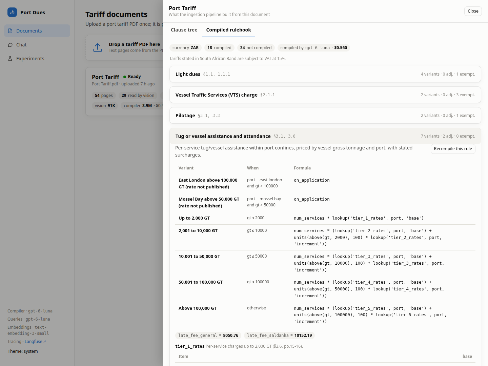

### 4. Answering a question

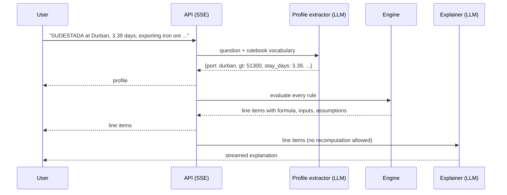

- **Vocabulary-driven profile.** The profile schema is generated from the rulebook's variables, so a
  document-specific fact (say, a tanker certification) becomes a field without code changes.
- **No guessing.** A fact the question doesn't give is never invented. An unnamed port or a missing commodity
  marks the charge *needs input*, and the answer asks for it.
- **Conversational.** Follow-ups ("same call, but at night") change only what they mention.

## Design decisions

### Compile once, compute deterministically

Pricing a call is arithmetic over rates, bands and conditions, and the architecture treats it that way. The
alternatives were benchmarked on the same golden set:

| Approach | Charges within ±1% | Exact cases | Latency | Tokens per answer |
|---|---:|---:|---:|---:|
| **Compiled rules + deterministic engine** | **100%** | **30/30** | **7 s** | **5.9k** |
| Agent using the compiled rules as a tool | 100% | 30/30 | 55 s | 26k |
| Agentic RAG over the clause tree | 70% | 16/30 | 112 s | 37k |

Compiled rules give the same accuracy as the most capable agent at a fraction of the latency and tokens. Every
line comes with its formula, inputs and assumptions, so quotes are reproducible and auditable.

### High accuracy on a small, low-cost model

Correctness comes from the verification layers and the deterministic engine, not from model size. That lets the
whole system run on `gpt-6-luna`, the lowest-cost model available: a tariff compiles for about $0.56, once, and a
question costs about $0.001. Each LLM call is routed by role (`compiler`, `fast`, `judge`), and each role's
model is set in `.env`, so a different model is a configuration change. Static prompt prefixes keep about 85%
of compile input in OpenAI's prompt cache.

### The reference values

| Charge | System | Brief | |
|---|---:|---:|---|
| Light dues | 60,062.04 | 60,062.04 | exact |
| Port dues | 199,371.35 | 199,549.22 | brief's value corresponds to a 3.396-day stay |
| Towage | 147,074.38 | 147,074.38 | exact |
| VTS | 33,345.00 | 33,315.75 | brief's value corresponds to 51,255 GT |
| Pilotage | 47,189.94 | 47,189.94 | exact |
| Running lines | 19,639.50 | 19,639.50 | exact; this figure is §3.8 *berthing* |

Solving the brief's figures back through the tariff shows where the two small gaps come from. Tell the system
the stay is 3.396 days and port dues come out at exactly 199,549.22. The VTS figure corresponds to a tonnage that
the brief's other charges don't use. The system also reports what the brief leaves out: §3.9 line handling
(3,309.12) and cargo dues (426,000.00, payable by the exporter).

## Evaluation

The golden set has 30 questions, 10 each **easy**, **medium** and **hard**. They cover band edges, minimum fees,
every port, out-of-hours surcharges, navy exemptions, bunkers-only and short-stay reductions, coaster status, and
free-text agent emails, plus the brief's reference vessel. Labels come from an independent hand transcription of
the tariff (`scripts/golden/za_reference.py`) that the application never imports.

| | Checks | Cost |
|---|---|---|
| `portdues check-rules <doc>` | compiled rules on the golden calls | free, deterministic |
| `portdues compare-rules <doc> other.json` | two rulebooks over ~300 calls, every difference listed | free |
| Experiments page / `portdues eval` | full pipeline, scored by numeric ±1%, an LLM judge and [Laya](https://huggingface.co/convaiinnovations/laya) | ~$0.03 for 30 questions |

Laya, an open-source System-1 decision model (ModernBERT, calibrated probabilities), scores coverage and
presentation with typed yes/no checks. Numeric correctness is scored deterministically and by the judge. Runs
stream live: KPIs, accuracy by difficulty, hit rate per charge, and a case table that opens expected vs
predicted, the judge's rationale and the trace.

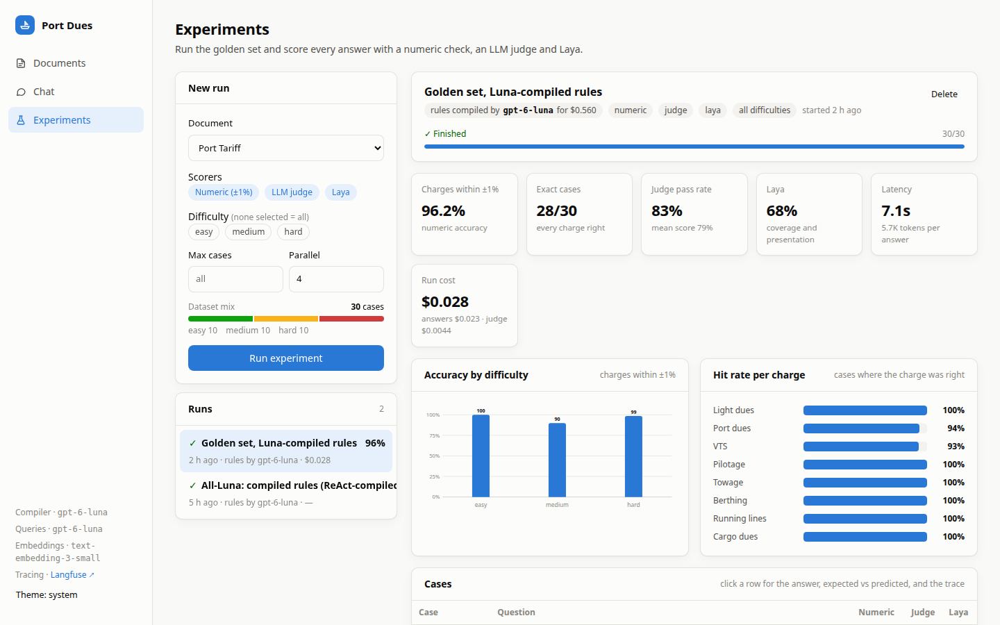

## Observability and cost

Docker Compose runs a self-hosted **Langfuse** (web, worker, Postgres, ClickHouse, Redis, MinIO), provisioned
from `.env` with sign-up disabled. One chat turn is one trace, and every answer in the UI links to it. At
startup the API registers a price for every usage key the OpenAI integration reports (input, cache reads and
writes, output, reasoning), so Langfuse's costs match the app's own to the cent.

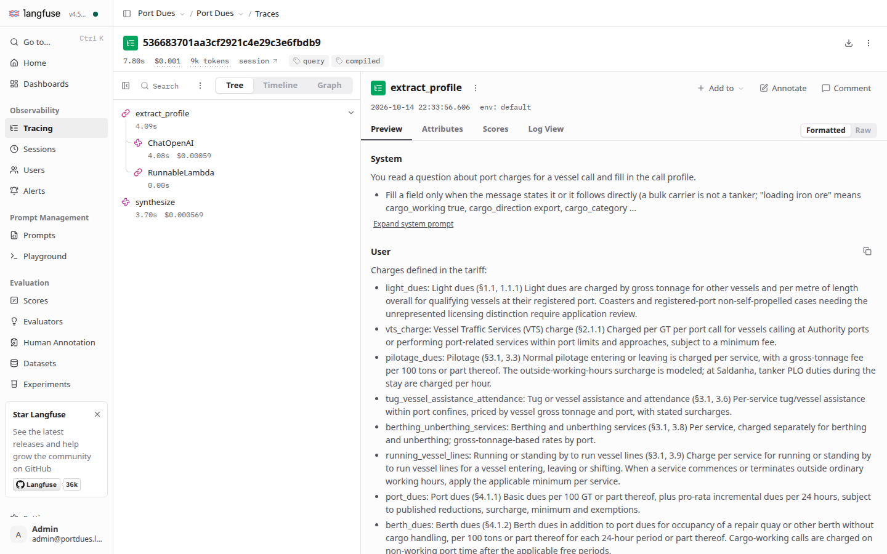

Every ingestion stage, compile, answer and eval case records input, output, cached and reasoning tokens and
dollars, shown in the UI and in Langfuse:

| Stage (54-page tariff, `gpt-6-luna`) | Input | Output | Cost |
|---|---:|---:|---:|
| Vision (29 pages) | 75k | 16k | $0.016 |
| Facts + digests (82 clauses) | 100k | 67k | $0.044 |
| Rule compilation (18 rules, verified) | 3.5M (85% cached) | 413k | $0.56 |
| One answer | ~5–9k | ~0.5k | ~$0.001 |

<details>
<summary>More screenshots: documents and a follow-up question</summary>

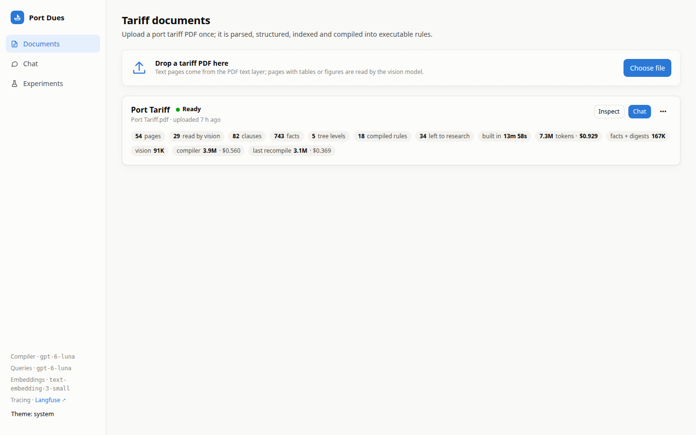

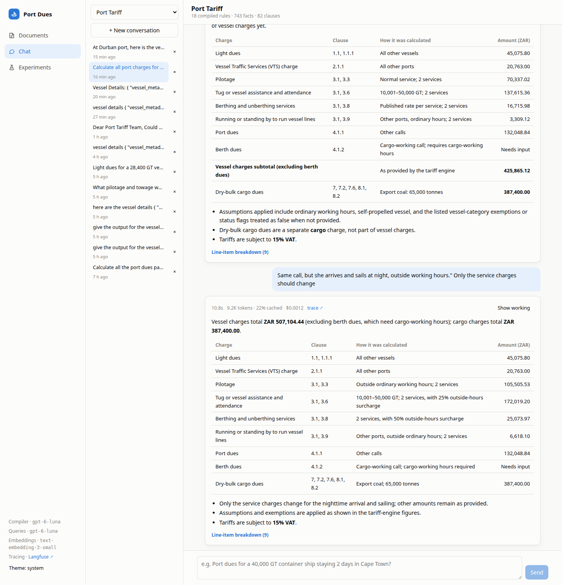
</details>

## Running it

```bash
cp .env.example .env          # OPENAI_API_KEY, Langfuse admin login and keys
docker compose up --build -d  # app → http://localhost:8080 · Langfuse → http://localhost:3000
```

Upload the tariff PDF on the Documents page. Reading and compiling take about fifteen minutes, once; uploading
the same file again reuses everything. The Laya scorer adds a CPU build of PyTorch to the image
(`WITH_LAYA=false docker compose build` leaves it out).

<details>
<summary>Local development, CLI and tests</summary>

```bash
make infra && make langfuse                     # postgres :5434, qdrant :6333, langfuse :3000
cd backend && uv venv && uv pip install -e ".[dev,laya]"
.venv/bin/portdues ingest "../Port Tariff.pdf"
make api                                        # :8000
make web                                        # :5173, proxies /api
make test                                       # engine, compiler verification, sectioning, scoring
```

| CLI | |
|---|---|
| `portdues ingest <pdf>` / `--compile-only <doc> [--rules id ...]` | read and compile, or recompile the rulebook or single rules |
| `portdues ask <doc> "question"` | one question from the terminal |
| `portdues check-rules <doc>` | free rulebook score on the golden calls |
| `portdues compare-rules <doc> rulebook.json` | free comparison with another rulebook |
| `portdues eval <doc> --limit 9` | an experiment from the terminal |

Models, effort levels, prices and compile samples are all set in `.env` (`COMPILER_MODEL`, `FAST_MODEL`,
`JUDGE_MODEL`, `MODEL_PRICES`, `COMPILE_SAMPLES`); see `.env.example`.
</details>

<details>
<summary>API</summary>

| Method | Path | |
|---|---|---|
| `POST` | `/api/documents` | upload a PDF; starts ingestion, deduplicated by hash |
| `GET` | `/api/documents`, `/api/documents/{id}` | status, progress, stats, tokens and cost |
| `POST` | `/api/documents/{id}/reingest?compile_only=` | rebuild everything, or only the rulebook |
| `POST` | `/api/documents/{id}/rules/{rule_id}/recompile` | recompile one rule |
| `GET` | `/api/documents/{id}/tree`, `/sections/{node}` | clause tree with digests, facts and verbatim text |
| `GET` | `/api/documents/{id}/rulebook` | compiled rules and how they were produced |
| `POST` | `/api/chat` | SSE stream of one turn |
| `GET` | `/api/conversations/{id}/messages` | chat history with each turn's line items and trace link |
| `POST` | `/api/experiments`, `GET /api/experiments/{id}/stream` | start a run; live per-case scores over SSE |
</details>

<details>
<summary>Layout</summary>

```
backend/portdues
  ingestion/   pages.py (PDF + vision) · sections.py (clause tree) · tree.py (facts + digests) · pipeline.py
  rules/       schema.py (rule language) · engine.py (evaluator, validator) · compiler.py (agent + verification)
  agents/      tools.py (tree tools) · profile.py (question → call profile) · strategies.py (answering)
  evals/       golden.jsonl · scorers.py · runner.py · rulebook_check.py (check-rules, compare-rules)
  storage/     db.py (PostgreSQL) · vectors.py (Qdrant)
  api/         FastAPI routers (documents, chat, experiments)
backend/scripts/golden   dataset builder and the labelling reference
frontend/src             React app: documents, chat, experiments
```
</details>

## Roadmap

- **Rule review** in the rulebook view: approve or edit a compiled rule, with the engine re-validating on save.
- **On-demand pricing** for situational services (dry-docking, fire services, equipment hire) that sit outside
  the routine-call rulebook.
- **Port selector** in the chat, making the "given vessel and port" input explicit.
- **Amending notices:** rule precedence by effective date for tariffs updated mid-year.
- **VAT-inclusive totals** as an option (amounts are quoted net, matching the reference values).
